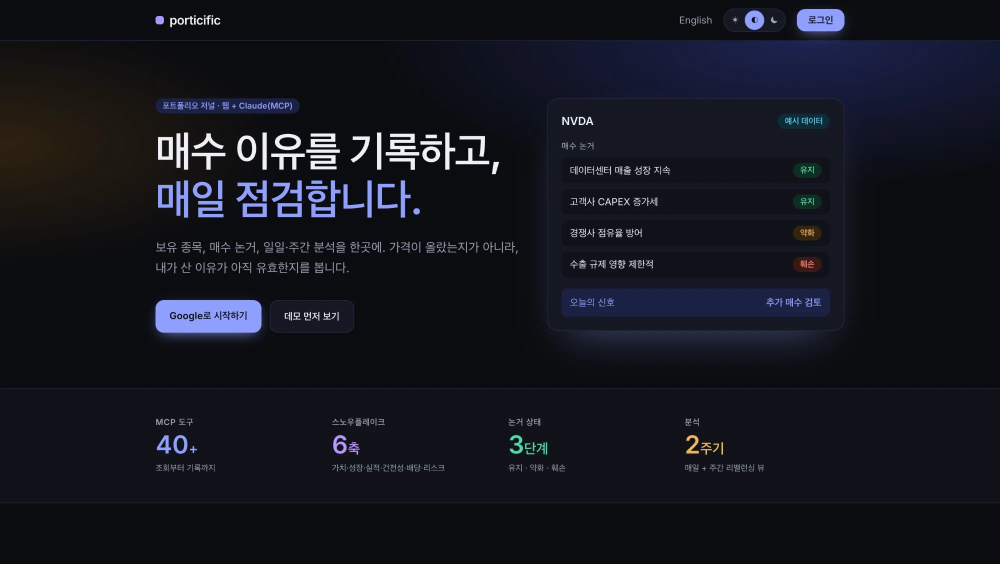
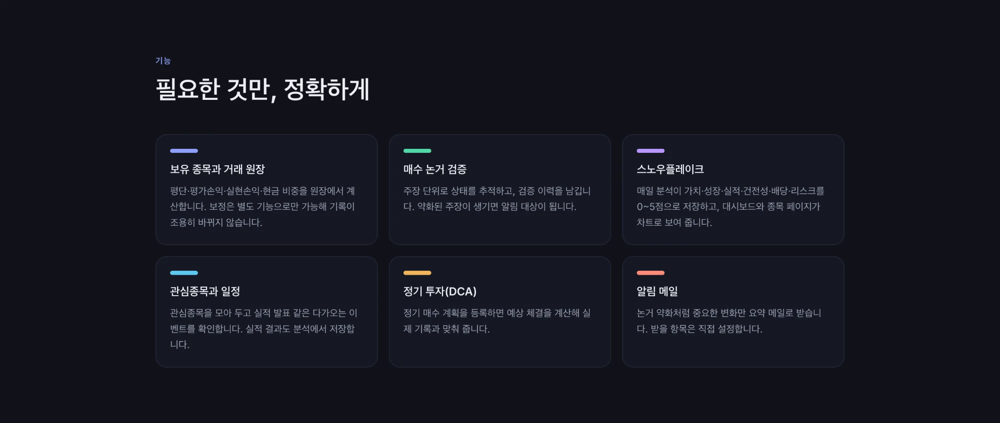

# porticific

[English](README.md) · **한국어**

포트폴리오 저널 서비스입니다. 종목을 **왜 샀는지**(매수 논거)를 기록하고, 매일 그 논거를 점검하고, 실시간 시세를 한곳에서 봅니다. 웹 UI와 MCP 클라이언트(Claude Desktop, Claude.ai, Claude Code) 모두에서 같은 데이터를 씁니다.

> 개인 투자 기록 도구이며 **투자 자문이 아닙니다.** [면책](#라이선스--면책)을 참고하세요.





## 기능
- **웹 UI** — 대시보드, 종목별 페이지(논거, 분석 이력, 가격 차트, 거래), 관심종목, 거래, 설정
- **MCP 서버** — `/api/mcp`, 포트폴리오 조회와 편집용 도구 34개(매수·매도 기록, 논거와 논거 주장, 관심종목, 태그, 정기 투자 계획). OAuth(Claude.ai 커넥터) 또는 API 키로 연결
- **논거 추적** — 매수 논거를 검증 가능한 주장으로 쪼개 *유지 / 약화 / 훼손* 상태를 이력으로 추적
- **일일 분석** — 매수 논거와 전날 분석을 기준으로 종목별 신호와 근거, 포트폴리오 요약, 관심종목 최우선 후보 정리(선택한 종목만 요청 시 실행. 사용자가 설정에 암호화해 저장한 본인 Anthropic 키로 실행하거나, 본인 Claude가 `analysis_context` + `save_analysis`로 직접 분석. 서버 `ANTHROPIC_API_KEY`는 소유자 계정과 주간 논거 점검에만 쓰이며, 저장 키 암호화에 `KEY_ENCRYPTION_SECRET` 필요)
- **이메일 요약** — 신호 변화와 다가오는 일정을 알려 주는 알림(사용자별 선택 가입)
- **보안 모델** — 사용자별 테이블은 모두 `user_id`와 RLS(소유자 `SELECT` 정책만, 쓰기 정책 없음)를 가집니다. 모든 쓰기는 호출자를 검증한 뒤 서버 코드로만 수행하고, 매수·매도는 service role만 실행할 수 있는 원자적 SQL 함수입니다

## 기술 스택
Next.js(App Router, TypeScript) · Supabase(Postgres, Auth, RLS) · Google OAuth · Anthropic API · Vercel 배포 가능

## 설치
```bash
cp .env.local.example .env.local   # 값 채우기
npm install
npm run dev
```
1. Supabase 프로젝트를 만들고 `supabase/migrations/`를 순서대로 적용합니다(CLI: `supabase db push`).
2. Supabase Auth에서 Google 제공자를 켭니다. 허용 리디렉션 URL에 `http://localhost:3000/auth/callback`(과 운영 URL)을 추가하고, Google OAuth 클라이언트에 `https://<ref>.supabase.co/auth/v1/callback`을 추가합니다.
3. 한 번 로그인한 뒤, 혼자 쓰는 동안에는 Supabase Auth의 신규 가입을 꺼 두는 것을 권합니다.

## 배포 (Vercel)
- 레포를 가져와 `.env.local.example`의 환경 변수를 설정합니다(`CRON_SECRET` 포함, Vercel이 크론 경로에 전달합니다).
- `vercel.json`은 `/api/cron/prices`를 미국 장 마감 후 평일에(자동 일일 분석 없음), `/api/cron/thesis-check`를 토요일에, `/api/cron/alerts`를 매일 실행합니다(이메일 요약은 설정에서 사용자별로 켬, `ALERT_SMTP_USER` / `ALERT_SMTP_PASS` 필요, 예: Gmail 앱 비밀번호). Vercel Hobby는 하루 한 번 크론만 허용합니다.
- 10분 간격 장중 시세가 필요하면 레포 시크릿 `SUPABASE_URL`, `SUPABASE_SERVICE_ROLE_KEY`를 설정하세요. 그러면 `.github/workflows/fetch-prices.yml`이 `scripts/fetch_prices.py`를 실행합니다.
- `NEXT_PUBLIC_SITE_URL`을 운영 도메인으로 설정합니다(설정 페이지에 표시됨).

## Claude 연결
- **Claude.ai / Claude Desktop 커넥터**: 사용자 지정 커넥터에 `https://<your-domain>/api/mcp`를 추가합니다. Google로 로그인하고 동의 화면이 표시됩니다.
- **API 키**: 설정에서 키를 만든 뒤
  ```bash
  claude mcp add --transport http porticific https://<your-domain>/api/mcp \
    --header "Authorization: Bearer prt_..."
  ```

## 시세 데이터
시세는 `src/lib/prices/`의 provider 인터페이스를 통해 가져옵니다. 기본 provider는 비공식(Yahoo Finance)이며 **개인 용도 전용**입니다. 다른 사람에게 서비스를 열기 전에 라이선스가 있는 provider로 교체하세요.

## 개발
```bash
npm run lint && npm run typecheck && npm test && npm run build
```
비즈니스 로직은 `src/lib/`에 있고 UI 서버 액션과 MCP 도구가 공유합니다. 규칙은 [`CLAUDE.md`](CLAUDE.md)를 참고하세요. 스키마 변경은 `supabase/migrations/`에 새 파일로만 추가합니다(적용된 파일은 수정 금지).

## 라이선스 / 면책
MIT, [`LICENSE`](LICENSE) 참고. 이 프로젝트의 어떤 내용도 투자 자문이 아니며, 시세는 지연되거나 부정확할 수 있습니다. 기본 시세 provider는 비공식 라이브러리(`yahoo-finance2`, `yfinance`)로 Yahoo Finance를 사용하며 개인 용도 전용입니다. Supabase 프로젝트와 API 키는 직접 준비하세요. 이 레포에는 자격 증명이 포함되어 있지 않습니다.
